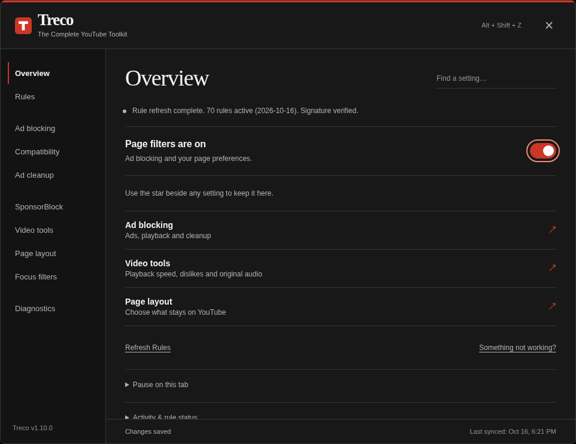

<div align="center">
  
  <h1>Treco</h1>
  <p><strong>The Complete YouTube Toolkit</strong><br>All the tricks you need for a better YouTube.</p>
  <p>
    <a href="https://raw.githubusercontent.com/rafelolv/Zynubo/main/Treco.user.js"></a>
    <a href="https://github.com/rafelolv/Zynubo/releases/download/v1.9.0/Zynubo-chromium-v1.9.0.zip"></a>
    <a href="https://github.com/rafelolv/Zynubo/releases/download/v1.9.0/Zynubo-firefox-v1.9.0.zip"></a>
  </p>
  <p><a href="#install">Installation</a> · <a href="#use-treco">How to use</a> · <a href="#need-help">Get help</a></p>
</div>

Treco is a free, open-source tool for YouTube. It lets you:

- **Block ads** in videos and around the page.
- **Skip sponsor segments** with SponsorBlock, if you enable it.
- **Clean up your feed** by hiding Shorts, comments and other distractions you choose.
- **Filter videos** by channel, keyword or length.
- **Adjust playback speed** up to 10× from a button in the video player, with a quick reset to 1×.

Treco was previously named Zynubo. The repository address remains the same so existing update links keep working.

## Install

**Choose one method.** The userscript is the simplest option for most people. You do not need to download this repository or run any commands.

| Option | What you need | Updates |
| --- | --- | --- |
| **Userscript — recommended** | Tampermonkey or Violentmonkey | Your manager checks for updates. |
| **Chrome / Brave / Edge extension** | A downloaded ZIP, loaded through Developer mode | Replace the files and reload the extension. |
| **Firefox extension — temporary** | A downloaded ZIP, loaded as a temporary add-on | Load it again after closing Firefox. |

### Userscript

1. Install [Tampermonkey](https://www.tampermonkey.net/) or [Violentmonkey](https://violentmonkey.github.io/). These browser add-ons run scripts like Treco.
2. **[Click here to install Treco](https://raw.githubusercontent.com/rafelolv/Zynubo/main/Treco.user.js)** and confirm in your manager.
3. Open or reload [YouTube](https://www.youtube.com/).

If the link opens plain text, follow the [manual installation steps](docs/USER-GUIDE.md#manual-installation). If Treco does not start on Chrome, check **Allow User Scripts** in your manager's extension details.

### Browser extension

The download buttons currently provide the last published **Zynubo 1.9.0** packages. Treco packages can be built from this branch using the extension guide; the next release will update these buttons.

Use the **Chrome / Brave / Edge** or **Firefox** download button above, then follow the **[extension installation guide](docs/EXTENSIONS.md)** to extract and load the ZIP. No Tampermonkey or Violentmonkey is needed.

**These are local installations, not browser-store downloads.** The Firefox extension is unsigned and disappears when Firefox closes. For a setup that stays installed, use the userscript.

Keep only **one Treco installation** enabled in each browser.

## Use Treco

1. **Open settings:** click **Treco** in YouTube's top-right header, or press **Alt+Shift+Z** outside a text field. You can also use your userscript manager's menu or the extension's toolbar icon.
2. **Find an option:** choose a section or use **Find a setting**. Each option explains what it does; expand **Technical details** if you want more information.
3. **Make it yours:** turn options on or off. Changes save automatically. Star your favorites to keep them together in **Overview**.

In **Video tools**, enable **Hide player speed button** to remove the speed button from the player. You can still change speed from the panel.



[See the light theme, mobile layout and extension popup](docs/UI.md). Screenshots come from local test pages.

SponsorBlock, DeArrow and Return YouTube Dislike ask for permission before connecting to their services. DeArrow is available only in the userscript. See [privacy details](docs/PRIVACY.md).

## Updates and pausing

- **Userscript:** check for updates in Tampermonkey or Violentmonkey, then reload YouTube. It receives updates from this repository's `main` branch.
- **Extensions:** download a new release, replace the local files and reload. The ZIP buttons point to the published release, which can be older than the userscript. [Full update steps](docs/USER-GUIDE.md#updates).
- **Pause:** use **Pause on this tab** in Overview. With an extension, browser network rules stay active while the page engine is paused. Disable the extension in your browser to stop those rules too.

## Need help?

Start by reloading YouTube. If the problem continues, temporarily disable other YouTube blockers and older Treco installations, then follow the **[troubleshooting guide](docs/USER-GUIDE.md#troubleshooting)**.

Still stuck? **[Report a problem](https://github.com/rafelolv/Zynubo/issues/new?template=bug_report.yml)** with your browser, Treco version and what happened. In **Diagnostics**, you can review, copy or download a report. Review it before sharing; never post cookies, tokens or private URLs.

YouTube changes can affect playback and blocking. An active status does not guarantee that every ad was blocked.

<details>
<summary><strong>For developers</strong></summary>

Use Node.js 24 (see `.nvmrc`), npm and Python 3:

```sh
npm ci
npm run check
```

Edit the engine in `src/core.user.js`, styles in `src/ui/`, and browser adapters in `src/extension/`. Run `npm run build` to generate the userscript and extension folders, or `npm run package` to create ZIPs.

Browser tests use simulated pages and do not prove live YouTube ad blocking. See [validation](docs/VALIDATION.md), [contributing](CONTRIBUTING.md), [maintenance](docs/MAINTENANCE.md) and [releasing](docs/RELEASING.md).

</details>

---

Maintained by [rafelolv](https://github.com/rafelolv) · [MIT License](LICENSE) · [Changelog](CHANGELOG.md)

Based on Matthew Parker's YoutubeAdblock. Required attribution and separate filter/service terms are preserved in [third-party notices](THIRD_PARTY_NOTICES.md).
