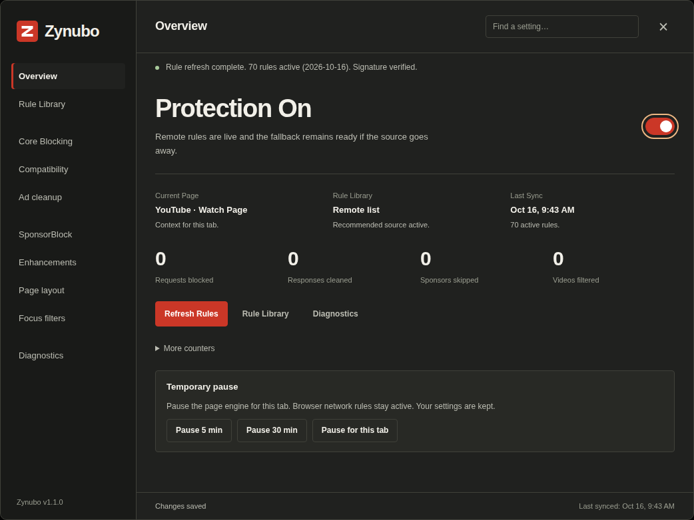

<div align="center">
  
  <h1>Zynubo</h1>
  <p>Less interruption. More YouTube.</p>
  <p>
    <a href="https://raw.githubusercontent.com/rafelolv/Zynubo/main/Zynubo.user.js"></a>
    <a href="https://github.com/rafelolv/Zynubo/releases/download/v1.1.0/Zynubo-chromium-v1.1.0.zip"></a>
    <a href="https://github.com/rafelolv/Zynubo/releases/download/v1.1.0/Zynubo-firefox-v1.1.0.zip"></a>
  </p>
  <p><a href="docs/USER-GUIDE.md">User guide</a> · <a href="https://github.com/rafelolv/Zynubo/issues">Get help</a></p>
</div>

Zynubo blocks ads, skips sponsors when you allow it, and helps you customize YouTube. Use the userscript or a standalone browser extension — both share the same engine and settings interface.

## Install

### Userscript — recommended

This is the easiest setup for **Chrome, Brave, Edge and Firefox**. No terminal or repository download needed.

1. Install [Tampermonkey](https://www.tampermonkey.net/) or [Violentmonkey](https://violentmonkey.github.io/), a browser add-on that runs userscripts.
2. **[Install Zynubo](https://raw.githubusercontent.com/rafelolv/Zynubo/main/Zynubo.user.js)** and confirm the installation in your manager.
3. Open [YouTube](https://www.youtube.com/) and reload the page.

Keep **one Zynubo installation** enabled. Disable older upstream scripts and other YouTube-specific blockers while checking for conflicts.

**Chrome + Tampermonkey:** if nothing happens, check **Allow User Scripts** in the manager's extension details. If the install link opens plain text, use the [manual installation guide](docs/USER-GUIDE.md#manual-installation).

<details>
<summary><strong>Standalone extensions for Chrome, Brave, Edge and Firefox</strong></summary>

Extensions run without a userscript manager. Follow the **[local extension guide](docs/EXTENSIONS.md)** for installation and updates.

Download the ZIP for your browser using the buttons above or [GitHub Releases](https://github.com/rafelolv/Zynubo/releases/latest). Chromium ZIPs load through Developer mode. Firefox ZIPs are unsigned and work only as temporary installs; they disappear when Firefox closes.

Zynubo has no browser-store listing or signed XPI yet. Follow the guide to extract and load the ZIP; neither package needs build commands or a userscript manager.

</details>

## Quick start

1. Open your userscript manager's menu and choose **Zynubo: Open Control Center**. With the extension, click the Zynubo toolbar icon, then **Open Control Center**.
2. Use **Overview** to check the page engine and counters. Choose a settings section or search with **Find a setting**.
3. Turn on the options you want. Changes save automatically.

SponsorBlock, DeArrow and Return YouTube Dislike ask for permission before contacting their services. DeArrow is available only in the userscript. [Privacy details](docs/PRIVACY.md).



[Light theme, narrow layout and popup previews](docs/UI.md). These captures use local test pages.

## Useful tips

- **Updates:** your userscript manager checks the script on `main` for updates. Local extensions need a manual file replacement and reload. [Update guide](docs/USER-GUIDE.md#updates).
- **Pause:** the page switch and temporary pause stop the page engine. With an extension installed, its browser network rules remain active; disable the extension to stop those too.
- **Status:** an engine response means it initialized, not that every ad was blocked. YouTube changes can affect playback and blocking.

## Help

Start with [troubleshooting](docs/USER-GUIDE.md#troubleshooting). If the problem persists, **[report it here](https://github.com/rafelolv/Zynubo/issues/new?template=bug_report.yml)** with your browser, Zynubo version, installation method and what happened. Never share tokens, cookies or private URLs.

<details>
<summary><strong>Development and validation</strong></summary>

Use Node.js 24 (the reference version is in `.nvmrc`), npm and Python 3:

```sh
npm ci
npm run check
```

Edit the shared engine in `src/core.user.js`, styles in `src/ui/`, and browser adapters in `src/extension/`. Generate the userscript and extension folders with `npm run build`, or create ZIPs with `npm run package`.

Browser tests use simulated pages and do not prove live YouTube ad blocking. See [validation](docs/VALIDATION.md), [contributing](CONTRIBUTING.md), [maintenance](docs/MAINTENANCE.md) and [releasing](docs/RELEASING.md).

</details>

---

Maintained by [rafelolv](https://github.com/rafelolv) · [MIT License](LICENSE) · [Changelog](CHANGELOG.md)

Based on Matthew Parker's YoutubeAdblock. Required attribution and separate filter/service terms are preserved in [third-party notices](THIRD_PARTY_NOTICES.md).
