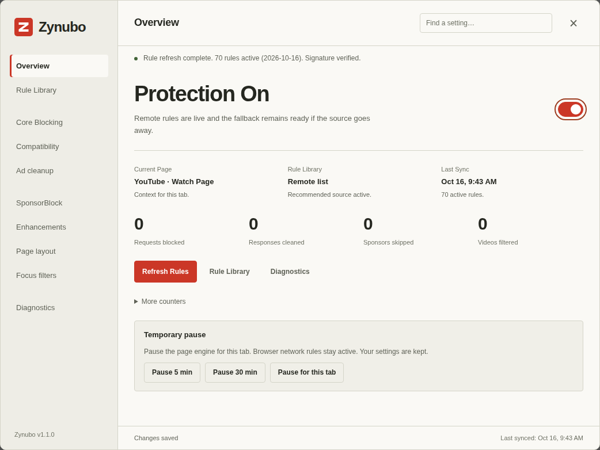
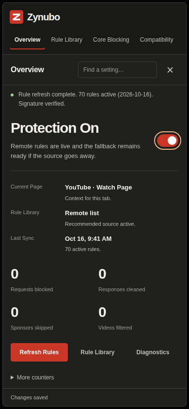
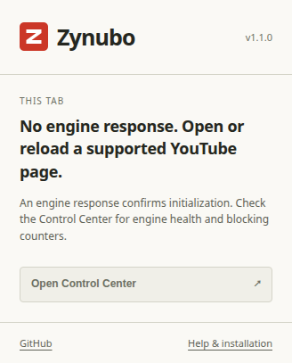

# Interface

Zynubo 1.1.0 uses graphite and warm paper surfaces, a red Z mark, restrained
borders and a single accent for primary actions. The panel and extension popup
share the palette in src/ui/theme.json; all logo paths originate in images/icon.svg.
Fonts are local system fonts. No remote fonts, images or CSS are required to
render the interface.

Choose one section from the navigation. Search shows all matching sections;
Escape clears a nonempty search before closing the dialog. Settings are saved
automatically. Technical counters remain available under More counters. The
interface distinguishes page-engine state from browser network rules and does
not use counters or startup responses as proof of live ad blocking.

The sidebar becomes a horizontally scrollable section list on narrow screens.
Switches keep their label alignment, focus targets exclude hidden sections, and
rebuilding a selected page preserves its focus and scroll. Closing and reopening
starts from Overview.

These are actual browser fixture captures using the generated 1.1.0 engine,
not design mockups or live YouTube evidence. See VALIDATION.md for test scope.

## Dark

## Light

## Narrow viewport

## Extension popup

Edit panel styles in src/ui/panel.css and popup styles in src/extension/popup.css.
The build compiles scoped tokens and embeds the panel CSS into the shared engine;
never hand-edit generated CSS or add another override layer inside the core.
