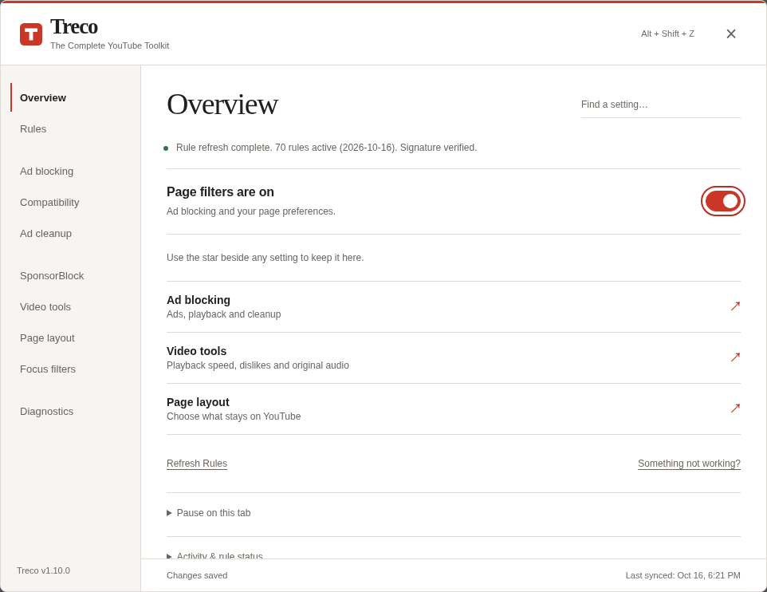
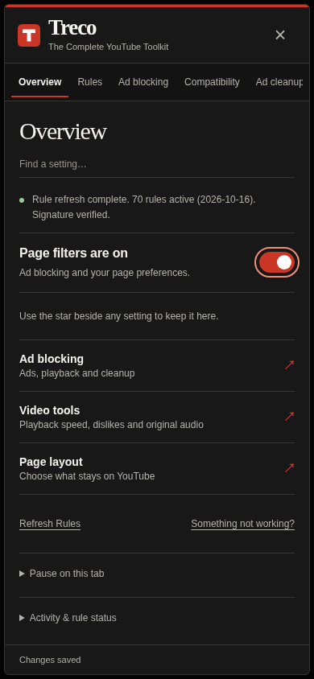
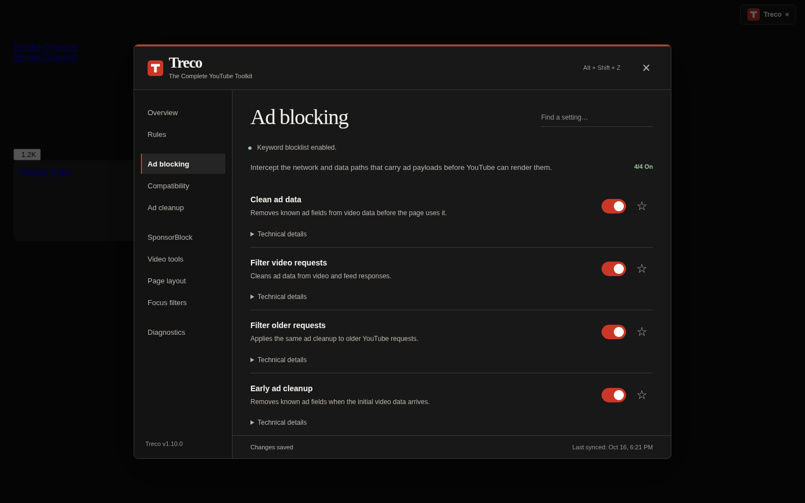
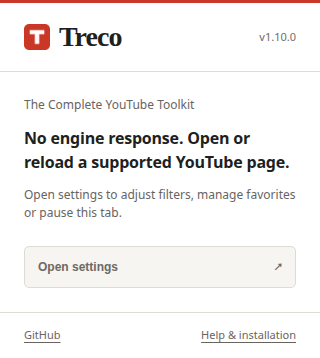

# Interface

Treco 1.10.0 uses a neutral black/white palette, the red T mark and local serif
headings. One full-width brand bar and a compact section list frame plain setting
rows. The main header shows the current section title without a repeated heading
below it. Search retains titles for each matching section.

Overview has a compact page-filter switch, favorites and three direct links.
Counters and rule metadata are behind **Activity & rule status**. Temporary
pause controls are behind **Pause on this tab** and expand automatically during
a recovery pause. Warnings remain visible when they need attention.

Settings pages open directly. The sidebar becomes a horizontally scrollable
section list on narrow screens, with search on a separate line. Keyboard focus
includes disclosure summaries, excludes hidden pages, and returns to a sensible
control after rebuilding settings. Home links announce their destination by
focusing the section heading. Reopening starts at Overview.

The userscript and both extension packages embed the same compiled panel CSS.
The extension popup shares tokens and typography. Fonts are local; the canonical
logo is images/icon.svg. No remote font, image or stylesheet is required to render
the interface. Engine state and counters do not certify live ad blocking.

These native browser captures use the generated 1.10.0 engine with synthetic data.
They are not design mockups or evidence of live YouTube compatibility.

## Dark

## Light

## Narrow viewport

## Settings rows

## Extension popup

Edit src/ui/panel.css, src/ui/theme.json and src/extension/popup.css, then rebuild.
See VALIDATION.md for browser versions, tests and limitations.
